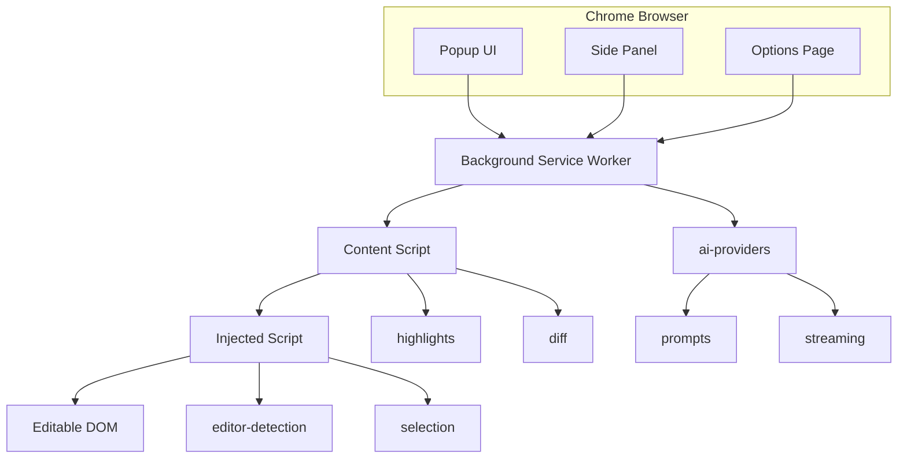

# AI Writing Assistant — Architecture

## Overview

AI Writing Assistant is a Manifest V3 Chrome extension that provides Grammarly-style writing assistance across any editable webpage. It uses a Turborepo monorepo with domain-specific packages for editor detection, AI streaming, and suggestion rendering.

## Context Diagram

## Extension Contexts

| Context | Purpose |
|---------|---------|
| Background SW | AI request routing, analytics, privacy settings |
| Content Script | Bridge between page and extension, highlight rendering |
| Injected Script | Editor detection, selection tracking (main world) |
| Popup | Quick writing actions |
| Side Panel | Streaming suggestions, diff preview |
| Options | AI provider keys, privacy controls |

## Message Flow

1. Injected script detects editor → `EDITOR_DETECTED` → background
2. User selects text → `SELECTION_CHANGED` → background
3. User triggers action → `AI_REQUEST` → background → provider adapter
4. Provider streams → `AI_STREAM_CHUNK` → side panel
5. User accepts → diff applied via content script

## Package Boundaries

| Package | Module | Responsibility |
|---------|--------|---------------|
| `@awa/editor-detection` | 2 | Universal editable field finder |
| `@awa/selection` | 3 | Range/Selection API engine |
| `@awa/ai-providers` | 4 | LLM adapter registry |
| `@awa/prompts` | 5 | Prompt template orchestration |
| `@awa/streaming` | 6 | AbortController + ReadableStream |
| `@awa/diff` | 7 | Sentence-level incremental diff |
| `@awa/highlights` | 8 | CSS Highlight API rendering |
| `@awa/analytics` | 12 | Local-only usage metrics |

## Key Design Decisions

- **Injected script for detection:** Content scripts can't access page JS variables; injected script runs in main world for full DOM access including Shadow DOM
- **CSS Highlight API over DOM mutations:** Zero DOM mutation for grammar underlines — better performance and compatibility
- **Provider adapter pattern:** Swap OpenAI/Gemini/Anthropic without changing UI code
- **Sentence-level diffing:** Only re-analyze changed sentences — 80%+ reduction in AI API calls
